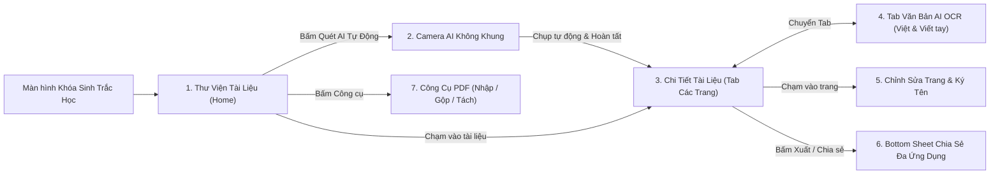

# Tài Liệu Đặc Tả & Bộ Prompt Thiết Kế UI/UX Trên Google Stitch
**Dự án**: Ứng dụng **Scan Tài Liệu AI (Offline & On-Device AI)** — Phiên bản `v1.1.0`  
**Nền tảng mục tiêu**: iOS 16+ & Android 10+ (Mobile App - Material 3 kết hợp Cupertino tinh gọn)  
**Định hướng cốt lõi**:
1. **Quét AI không khung giới hạn (Frameless AI Document Detection)**: Loại bỏ hoàn toàn khung chữ nhật an toàn cố định; AI tự động phát hiện tờ giấy ở bất kỳ vị trí/góc nghiêng nào trong ống kính và vẽ lưới đa giác động bám sát 4 cạnh giấy.
2. **Hybrid Offline + On-Device AI OCR (Tiếng Việt & Chữ viết tay)**: Kết hợp mô hình AI nội bộ (Tesseract 5 LSTM `vie` + Apple Vision `vi-VT` + ML Kit v2) không qua máy chủ bên thứ 3, cho phép xem, tìm kiếm, chỉnh sửa và quét lại từng trang.
3. **Xuất & Chia sẻ đa ứng dụng toàn diện**: Chia sẻ trực tiếp PDF (nhúng lớp chữ Unicode Tiếng Việt), bộ ảnh JPG hoặc văn bản OCR qua Zalo, Gmail, Messenger, Google Drive, AirDrop; lưu vào thư mục máy và in ấn.
4. **Giao diện trực quan, nút bấm gọn gàng (Compact Icon-First UI)**: Sử dụng phông chữ `Be Vietnam Pro`, tối giản chữ thừa, ưu tiên các nút biểu tượng (icon buttons) bo tròn tinh tế.

---

## 1. Hệ Thống Thiết Kế (Design System) Dùng Cho Stitch

Khi thiết lập Style / Theme trên Stitch, sử dụng bộ thông số chuẩn sau:

### 1.1. Bảng Màu (Color Palette)
| Vai trò | Mã màu (Light Mode) | Mã màu (Dark / Editor Mode) | Ý nghĩa sử dụng |
| :--- | :--- | :--- | :--- |
| **Primary (Chủ đạo)** | `#00695C` (Deep Teal) | `#26A69A` (Teal Accent) | Nút hành động chính (`Quét AI Tự Động`, `Chia sẻ PDF`), đa giác bắt mép tài liệu |
| **Primary Container** | `#E0F2F1` | `#004D40` | Nhãn số trang (`Trang 1`), biểu tượng nổi bật, chip trạng thái đang chọn |
| **Secondary / AI Accent** | `#00E5FF` / `#64FFDA` | `#64FFDA` | Tia quét AI, viền đa giác nhận diện giấy trên Camera, biểu tượng `✨ AI OCR` |
| **Background / Surface** | `#F8FAFB` / `#FFFFFF` | `#101316` / `#1C2126` | Nền danh sách thư viện sáng sạch; nền màn hình Camera & Chỉnh sửa ảnh tối sâu để nổi bật tờ giấy |
| **Border / Outline** | `#E2E8F0` | `#2D3748` | Viền thẻ (Card) mảnh `1px`, không dùng đổ bóng (shadow) dày gây rối mắt |
| **Semantic Status** | `#10B981` (Success), `#F59E0B` (Draft/Warning), `#EF4444` (Delete/Stamp) | Tương tự | Trạng thái khóa ổn định khi tự chụp, cảnh báo bản nháp, xóa trang / con dấu đỏ |

### 1.2. Phông Chữ & Phân Cấp Chữ (Typography)
- **Font Family**: `Be Vietnam Pro` (hiển thị hoàn hảo dấu Tiếng Việt kép như `ố`, `ể`, `ộ`, `ợ`, `đ`).
- **AppBar Title**: `16px - 17px`, `SemiBold (600)`.
- **Card Title (Tên tài liệu)**: `15px`, `Bold (700)`, cắt dòng `1 line ellipsis`.
- **Body / Văn bản OCR**: `14px - 15px`, `Regular (400)`, chiều cao dòng `1.5` dễ đọc và chọn khối văn bản.
- **Metadata / Chip / Nút phụ**: `11.5px - 12.5px`, `Medium (500)` hoặc `SemiBold (600)`.

### 1.3. Quy Chuẩn Linh Kiện Gọn Gàng (Compact UI Rules)
- **Card (Thẻ tài liệu & Thẻ trang)**: Bo góc `14px`, viền mảnh `1px`, padding trong `10px - 12px`.
- **Compact Action Pills (Nút thao tác trên từng trang)**: Cao `28px`, bo góc `8px`, nền xám nhạt `#F1F5F9`, gồm `Icon 14px` + `Nhãn ngắn 11px` (`Sửa/Lọc`, `AI OCR`, `Quét lại`).
- **Bottom Action Bar**: Cao cố định `64px - 72px`, tối đa 3 nút chính (ở màn hình Thư viện & Chi tiết) hoặc 5 nút icon dọc (ở màn hình Chỉnh sửa trang).

---

## 2. Sơ Đồ Luồng Màn Hình (Screen Flow)



---

## 3. Bộ Prompt Chi Tiết Cho Từng Màn Hình Trên Stitch (Copy & Paste)

> [!TIP]
> **Cách dùng hiệu quả nhất trên Google Stitch (`stitch.withgoogle.com`)**:
> - Bạn có thể copy **Prompt Tổng Thể (Master Prompt)** ở mục **3.1** để tạo khung toàn ứng dụng trước.
> - Sau đó copy từng **Prompt Màn Hình (3.2 -> 3.8)** để tạo hoặc tinh chỉnh chi tiết từng màn hình. Mỗi mục đều có sẵn cả bản **Tiếng Việt** và **Tiếng Anh** (Stitch thường sinh layout chuẩn xác hơn với bản Tiếng Anh nhưng vẫn giữ toàn bộ chữ hiển thị trên UI là Tiếng Việt).

---

### 3.1. Master Prompt — Tạo Tổng Thể Ứng Dụng (Project Overview Prompt)

#### Bản Tiếng Việt (Dán vào Stitch)
```text
Thiết kế giao diện ứng dụng di động iOS/Android hiện đại tên là "Scan Tài Liệu AI" (Offline AI Document Scanner & Vietnamese OCR).
Phong cách thiết kế: Material 3 kết hợp iOS hiện đại, tối giản, trực quan, các nút bấm gọn gàng ưu tiên icon (compact icon-first UI).
Bảng màu: Chủ đạo Deep Teal (#00695C), điểm nhấn AI Cyan/Mint (#26A69A), nền sáng (#F8FAFB) cho màn hình quản lý và nền tối (#14171A) cho màn hình Camera & Chỉnh sửa ảnh.
Phông chữ: Be Vietnam Pro. Toàn bộ nhãn giao diện bằng Tiếng Việt.
Ứng dụng gồm 6 màn hình chính:
1. Màn hình Thư viện Tài liệu: Thanh tìm kiếm OCR Tiếng Việt, thanh lọc thư mục dạng chip ngang, danh sách thẻ tài liệu gọn gàng có ảnh thu nhỏ + số trang + nút chia sẻ nhanh 1 chạm, và thanh điều hướng dưới cùng gồm 3 nút: "Nhập ảnh", nút chính nổi bật "Quét AI Tự Động" (có icon lấp lánh AI), và "Công cụ".
2. Màn hình Camera Quét AI Không Khung: Tuyệt đối KHÔNG có khung hình chữ nhật cố định giữa màn hình. Hiển thị camera toàn màn hình đang nhận diện một tờ tài liệu đặt hơi nghiêng trên bàn, với đường viền đa giác AI màu xanh ngọc (#00E5FF) bám sát 4 cạnh thực tế của tờ giấy, chấm tròn ở 4 đỉnh, vòng tiến trình tự động chụp 80% và thanh trạng thái nhỏ phía trên "Đang giữ ổn định... Tự chụp AI".
3. Màn hình Chi tiết Tài liệu (Tab Các trang): Danh sách các trang cho phép kéo thả sắp xếp, mỗi thẻ trang hiển thị ảnh trang, nhãn "Trang 1 • Màu sắc nét", 2 dòng xem trước văn bản OCR và 3 nút nhỏ gọn: "Sửa/Lọc", "AI OCR ✨", "Quét lại", cùng nút xóa.
4. Màn hình Chi tiết Tài liệu (Tab Văn bản AI OCR): Thanh tìm kiếm trong tài liệu, nút sao chép hết & chia sẻ hết, danh sách thẻ văn bản OCR Tiếng Việt có dấu đầy đủ và chữ viết tay của từng trang, kèm 4 nút icon nhỏ trên góc mỗi thẻ: Quét lại AI ✨, Chỉnh sửa văn bản, Sao chép, Chia sẻ.
5. Màn hình Chỉnh sửa Trang & Ký tên (Dark Mode): Hiển thị trang tài liệu với lưới cắt 4 góc phối cảnh có kính lúp phóng đại góc, dải chọn bộ lọc màu (Gốc, Màu sắc nét, Thang xám, Trắng đen, Tương phản cao), chữ ký tay và con dấu đỏ "ĐÃ ĐỐI CHIẾU" đặt trên trang, cùng thanh công cụ dưới gồm 5 nút gọn gàng: Cắt 4 góc, Xoay 90°, Ký tên, Đóng dấu, AI OCR.
6. Bảng Xuất & Chia sẻ Đa ứng dụng (Modal Bottom Sheet): Cho phép chọn Khổ giấy PDF (A4) và Chất lượng nén, 1 nút lớn nổi bật "Chia sẻ file PDF qua ứng dụng khác (Zalo, Gmail, Drive...)" và lưới 2x2 gồm 4 nút phụ: "Lưu PDF vào máy", "Xem & In PDF", "Chia sẻ ảnh JPG", "Chia sẻ chữ OCR".
```

#### Bản Tiếng Anh Chuẩn Cho Stitch (Khuyên dùng để sinh UI sắc nét nhất)
```text
Design a modern, clean mobile app UI (iOS 16+ & Android Material 3) for an offline AI Document Scanner app named "Scan Tài Liệu AI".
Use Vietnamese language for all UI text and labels. Font family: Be Vietnam Pro.
Color palette: Primary Deep Teal (#00695C), AI Accent Mint/Cyan (#00E5FF / #26A69A), Clean Light Surface (#F8FAFB) for library/detail views, and Pro Dark Surface (#14171A) for Camera and Page Editor views.
Design philosophy: Intuitive, clutter-free, compact icon-first buttons, 14px rounded cards with subtle 1px borders (#E2E8F0).
Include:
1. Home Library Screen with Vietnamese OCR search bar, folder filter chips, compact document cards with thumbnail, page count badge, 1-tap share icon, and a 3-button bottom bar ("Nhập ảnh", prominent primary button "Quét AI Tự Động" with sparkle icon, and "Công cụ").
2. Frameless AI Camera Scanner Screen (NO static rectangular guide box; instead, show a dynamic glowing cyan AI polygon mesh wrapping around a slightly tilted paper document on a desk, corner nodes, auto-shutter progress ring, and top status pill "Đang giữ ổn định... Tự chụp AI").
3. Document Detail Screen (Pages Tab & AI OCR Text Tab) with compact action pills ("Sửa/Lọc", "AI OCR", "Quét lại") and editable Vietnamese OCR cards.
4. Dark-mode Non-Destructive Page Editor with 4-corner perspective crop handles, filter chips, draggable handwritten signature & red stamp overlay, and a compact 5-icon bottom toolbar.
5. Cross-App Export & Share Bottom Sheet with paper size/quality dropdowns, a primary full-width share PDF button for Zalo/Gmail/Drive, and a 2x2 grid for Save to Device, Print PDF, Share JPGs, and Share OCR Text.
```

---

### 3.2. Màn Hình 1: Thư Viện Tài Liệu (Home / Library Screen)

**Tham chiếu mã nguồn**: [`lib/screens/library_screen.dart`](file:///f:/AI%20Code%20Productions/App%20Scan/lib/screens/library_screen.dart)

#### Prompt tạo riêng Màn hình 1 trên Stitch:
```text
Create a mobile screen for "Scan Tài Liệu AI" - Home Library Screen (Light Mode, #F8FAFB background, #00695C primary teal, Vietnamese UI text):
- Top AppBar:
  - Left: Rounded teal container icon (document scanner icon) + Title "Scan Tài Liệu AI" (17px bold) and subtitle "Quét tự động • OCR Tiếng Việt • PDF" (11.5px grey).
  - Right actions: 2 compact icon buttons: Built-in AI Camera icon and Shield/Biometric Security Settings icon.
- Search & Filter Section:
  - Rounded search bar (12px radius, white background, subtle border) with search icon and placeholder: "Tìm tên tài liệu, nội dung OCR, chữ viết tay...".
  - Horizontal scrollable filter chips below search bar: "Tất cả tài liệu" (selected, teal fill), "Hóa đơn & Biên lai", "Hợp đồng", "CCCD & Giấy tờ", "Tài liệu học tập", plus a compact "+ Thư mục" action chip.
- Optional Recovery Banner:
  - Compact amber banner (#FFFBEB) with history icon: "Có 1 phiên chụp đang dở (3 trang)" and text button "Mở lại".
- Document List (Vertical cards, 14px radius, 1px border #E2E8F0):
  - Each card has: Left 60x80px document page thumbnail, Middle column with Document Title ("Hợp đồng thuê nhà 2026", bold 15px), a teal pill badge "4 trang", timestamp "12/11/2026 10:30", and an highlighted yellow OCR match snippet "...Điều 2: Giá thuê và phương thức thanh toán...".
  - Right side of card: 2 compact icon buttons: Share PDF icon (ios_share) and Delete icon (red outline).
- Bottom Action Bar (White surface, top border, 3 buttons):
  - Left outlined button: Photo icon + "Nhập ảnh".
  - Center prominent filled teal button (flex 2): Sparkle AI icon + "Quét AI Tự Động".
  - Right outlined button: PDF tools icon + "Công cụ".
```

---

### 3.3. Màn Hình 2: Camera Quét AI Tự Động Không Khung (Frameless AI Camera Scanner)

**Tham chiếu mã nguồn**: [`lib/screens/scanner_screen.dart`](file:///f:/AI%20Code%20Productions/App%20Scan/lib/screens/scanner_screen.dart)

#### Prompt tạo riêng Màn hình 2 trên Stitch:
```text
Create a mobile screen for "Scan Tài Liệu AI" - Frameless AI Camera Scanner Screen (Full-screen dark camera interface, Vietnamese UI text):
- CRITICAL REQUIREMENT: Do NOT draw a static rectangular safety frame or fixed crop box in the center. The entire camera viewfinder is open and frameless.
- Camera Viewfinder Content:
  - Show a realistic paper contract/invoice lying at a slight perspective angle on a wooden desk.
  - Drawn directly over the detected paper edges is a glowing cyan/mint AI polygon quadrilateral (#00E5FF stroke, 15% teal translucent fill) with 4 glowing corner anchor dots and subtle AI scan lines across the paper.
- Top Overlay Bar (Translucent dark gradient):
  - Left: Close "X" icon button.
  - Center: Dynamic AI status pill with a circular progress indicator (75% filled in mint green): "Đang giữ ổn định... Tự chụp AI".
  - Right: 2 compact icon buttons: "Tự chụp" (Auto-capture toggle active in mint) and Flash toggle icon.
- Floating Native AI Switch Pill (Below top bar):
  - Translucent dark pill button with teal border and sparkle icon: "Mở Trình Quét AI Gốc (Cắt & Làm phẳng tự động)".
- Thumbnail Strip (Above bottom bar):
  - Horizontal strip showing 2 already-scanned page thumbnails (54x70px) with page badges "#1", "#2" and a small red remove "x" button on each.
- Bottom Control Bar (Solid dark #0F1215):
  - Left: Gallery import button (Photo icon + "Thư viện").
  - Center: Large 74px circular shutter button with a progress ring glowing in mint green (#64FFDA) and a camera/auto_awesome icon inside.
  - Right: Filled teal pill button with check icon: "Xong (2)".
```

---

### 3.4. Màn Hình 3: Chi Tiết Tài Liệu — Tab "Các Trang" (Document Detail - Pages Tab)

**Tham chiếu mã nguồn**: [`lib/screens/document_detail_screen.dart`](file:///f:/AI%20Code%20Productions/App%20Scan/lib/screens/document_detail_screen.dart)

#### Prompt tạo riêng Màn hình 3 trên Stitch:
```text
Create a mobile screen for "Scan Tài Liệu AI" - Document Detail Screen (Tab 1: "Các trang", Light Mode, Vietnamese UI text):
- AppBar:
  - Back arrow on the left.
  - Tappable Title area: "Hợp đồng dịch vụ số 18" with a small edit pencil icon next to it, and subtitle below: "Hợp đồng • 3 trang".
  - Right action: Compact Share icon button (ios_share_rounded).
  - Bottom of AppBar: 2-tab bar:
    - Tab 1 (Active, teal indicator): Grid icon + "Các trang".
    - Tab 2 (Inactive): Sparkle AI icon + "Văn bản AI OCR".
- Tag Chips & Helper Hint:
  - Compact tag chips: "#Hợp đồng", "#Quan trọng", "#2026".
  - Subtle hint row: Touch icon + "Chạm vào trang để sửa/lọc/ký tên • Giữ biểu tượng ☰ để đổi thứ tự trang".
- Reorderable Page Cards List (Vertical list of 3 page cards, 14px radius, 1px subtle border):
  - Each card contains:
    - Left: 66x88px crisp scanned page thumbnail.
    - Middle:
      - Top row: Teal badge "Trang 1", filter label "Màu sắc nét", and a small pen icon indicating signature attached.
      - Middle row: 2-line OCR preview text in Vietnamese: "CỘNG HÒA XÃ HỘI CHỦ NGHĨA VIỆT NAM - Độc lập - Tự do - Hạnh phúc...".
      - Bottom row of compact action pills (height 26px, 8px radius, soft grey fill):
        1. Tune icon + "Sửa/Lọc"
        2. Sparkle icon + "AI OCR"
        3. Camera switch icon + "Quét lại"
        4. Right-aligned compact red trash icon button.
    - Far Right: Drag handle icon (drag_indicator) for reordering pages.
- Bottom Navigation Bar (3 compact buttons):
  - Outlined button: "Thêm ảnh".
  - Outlined button: "Quét thêm".
  - Filled primary teal button: Share icon + "Xuất / Chia sẻ".
```

---

### 3.5. Màn Hình 4: Chi Tiết Tài Liệu — Tab "Văn Bản AI OCR" (Vietnamese & Handwriting OCR Tab)

**Tham chiếu mã nguồn**: [`lib/screens/document_detail_screen.dart`](file:///f:/AI%20Code%20Productions/App%20Scan/lib/screens/document_detail_screen.dart#L666-L785)

#### Prompt tạo riêng Màn hình 4 trên Stitch:
```text
Create a mobile screen for "Scan Tài Liệu AI" - Document Detail Screen (Tab 2: "Văn bản AI OCR", Light Mode, Vietnamese UI text):
- AppBar: Same header as Document Detail, with Tab 2 ("✨ Văn bản AI OCR") active.
- Top Search & Bulk Action Row:
  - Compact search input field: "Tìm trong văn bản OCR (Tiếng Việt / Viết tay)...".
  - 2 tonal icon buttons on the right of the search bar:
    - Copy All icon button (copy_all_rounded).
    - Share All OCR text icon button (ios_share_rounded).
- Per-Page OCR Cards List (Scrollable cards, 14px radius):
  - Card 1:
    - Header row: Left teal badge "Trang 1"; Right side has 4 compact icon buttons in a neat row:
      1. Sparkle icon (✨) for "Nhận diện lại AI OCR (Tiếng Việt & Chữ viết tay)"
      2. Edit note icon (📝) for "Chỉnh sửa văn bản OCR"
      3. Copy icon (📋) for "Sao chép trang này"
      4. Share icon (📤) for "Chia sẻ văn bản trang này"
    - Divider line.
    - Selectable Vietnamese OCR text body (Be Vietnam Pro 14px, 1.5 line height) showing accurate Vietnamese diacritics and recognized handwritten notes:
      "HỢP ĐỒNG CUNG CẤP DỊCH VỤ
      Bên A: Công ty TNHH Giải Pháp Số Việt Nam
      Ghi chú viết tay: Đã thanh toán đợt 1 ngày 12/11/2026 - Ký nhận: Nguyễn Văn Hùng".
```

---

### 3.6. Màn Hình 5: Chỉnh Sửa Trang Không Phá Hủy & Ký Tên (Non-Destructive Page Editor)

**Tham chiếu mã nguồn**: [`lib/screens/page_editor_screen.dart`](file:///f:/AI%20Code%20Productions/App%20Scan/lib/screens/page_editor_screen.dart)

#### Prompt tạo riêng Màn hình 5 trên Stitch:
```text
Create a mobile screen for "Scan Tài Liệu AI" - Page Editor Screen (Pro Dark Mode #14171A background, Vietnamese UI text):
- Top AppBar (#1C2126):
  - Left: Back arrow + Title "Trang 1".
  - Right: Sparkle AI OCR icon button (`✨`) + Compact filled teal button "✓ Lưu".
- Main Interactive Document Canvas (Center):
  - High-contrast scanned Vietnamese document page.
  - Show interactive 4-corner perspective crop overlay with teal lines, draggable corner handles, and a circular magnifier loupe in the top-left corner zooming in on the paper corner.
  - Also show a draggable handwritten blue ink signature box and a red rectangular verification stamp "ĐÃ ĐỐI CHIẾU" placed near the bottom of the document page.
  - Below canvas quick action chips: Outlined white pill "✨ AI bắt mép giấy", Outlined pill "Toàn trang", and Tonal pill "Áp dụng".
- Filter Selector Strip (#1C2126, height 56px, horizontal choice chips):
  - "Gốc", "Màu sắc nét" (selected in teal), "Thang xám", "Trắng đen", "Tương phản cao".
- Bottom Action Toolbar (#101316, 5 compact vertical icon+label buttons):
  1. Crop icon + "Cắt 4 góc" (active in teal accent)
  2. Rotate 90° icon + "Xoay 90°"
  3. Signature pen icon + "Ký tên"
  4. Stamp badge icon + "Đóng dấu"
  5. Sparkle icon + "AI OCR"
```

---

### 3.7. Màn Hình 6: Bảng Xuất File & Chia Sẻ Đa Ứng Dụng (Export & Share Bottom Sheet)

**Tham chiếu mã nguồn**: [`lib/screens/document_detail_screen.dart`](file:///f:/AI%20Code%20Productions/App%20Scan/lib/screens/document_detail_screen.dart#L252-L465)

#### Prompt tạo riêng Màn hình 6 trên Stitch:
```text
Create a mobile Modal Bottom Sheet UI for "Scan Tài Liệu AI" - Export & Cross-App Sharing Sheet (Light Mode, rounded top corners 24px with drag handle, Vietnamese UI text):
- Header Row:
  - Left rounded teal icon container with share icon.
  - Title: "Xuất & Chia sẻ tài liệu (3 trang)" (bold 16px).
  - Subtitle: "Hỗ trợ chia sẻ sang Zalo, Gmail, Messenger, Drive, AirDrop hoặc lưu vào máy" (12px grey).
- PDF Settings Row (2 side-by-side compact outlined dropdowns):
  - Left Dropdown: Label "Khổ giấy PDF", value "A4 (210 × 297 mm)".
  - Right Dropdown: Label "Chất lượng PDF", value "Cân bằng (Khuyên dùng)".
- Primary Action Button (Full width, prominent filled teal button, 12px radius, height 48px):
  - Share icon + "Chia sẻ file PDF qua ứng dụng khác (Zalo, Gmail...)".
- Secondary Actions Grid (2x2 grid of clean outlined buttons with icons):
  - Top-Left: Download icon + "Lưu PDF vào máy"
  - Top-Right: Print icon + "Xem & In PDF"
  - Bottom-Left: Image collection icon + "Chia sẻ ảnh JPG"
  - Bottom-Right: Text lines icon + "Chia sẻ chữ OCR"
```

---

### 3.8. Màn Hình 7: Công Cụ PDF & Khóa Sinh Trắc Học (PDF Tools & Biometric Lock)

**Tham chiếu mã nguồn**: [`lib/screens/pdf_tools_screen.dart`](file:///f:/AI%20Code%20Productions/App%20Scan/lib/screens/pdf_tools_screen.dart) & [`lib/screens/library_screen.dart`](file:///f:/AI%20Code%20Productions/App%20Scan/lib/screens/library_screen.dart#L156-L195)

#### Prompt tạo riêng Màn hình 7 trên Stitch:
```text
Create a split showcase of 2 utility screens for "Scan Tài Liệu AI" (Vietnamese UI text):
1. PDF Tools Screen ("Công cụ xử lý PDF ngoại tuyến"):
   - 3 clean action cards with teal icons:
     - Card 1: "Nhập tệp PDF có sẵn từ thiết bị" (Tách từng trang PDF thành ảnh chất lượng cao và nhận diện AI OCR Tiếng Việt). Button: "Chọn tệp PDF".
     - Card 2: "Gộp nhiều tài liệu (Merge)" (Chọn từ 2 tài liệu trở lên để nối thành một hồ sơ mới). Checkboxes on document list + Button: "Gộp các tài liệu đã chọn".
     - Card 3: "Tách trang tài liệu (Split)" (Nhập khoảng trang như 1-3, 5 để trích xuất thành tài liệu mới). Range input field + Button: "Tách thành tài liệu mới".
2. Biometric Lock Screen ("Kho Tài Liệu Đang Khóa"):
   - Centered minimalist security screen with a 72px teal lock icon inside a soft teal circle, title "Kho Tài Liệu Đang Khóa", subtitle "Xác thực bằng Vân tay / Face ID hoặc mã thiết bị để mở thư viện tài liệu scan cá nhân.", and a primary filled button "Mở khóa ngay".
```

---

## 4. Checklist Kiểm Tra Khi Tinh Chỉnh Trên Stitch

1. **Không còn khung căn giấy tĩnh**: Trên màn hình Camera, đảm bảo chỉ có đường viền đa giác động bám theo tờ giấy thật, không có khung vuông/chữ nhật cố định chắn tầm nhìn.
2. **Hiển thị chuẩn Tiếng Việt & Chữ viết tay**: Các đoạn văn bản mẫu trên màn hình OCR hiển thị rõ dấu Tiếng Việt (`Be Vietnam Pro`) và có cả phần ghi chú chữ viết tay đã nhận diện.
3. **Chia sẻ đa ứng dụng 1 chạm**: Luôn có nút Chia sẻ (`ios_share`) ngay trên từng thẻ tài liệu ở màn hình chính và bảng chia sẻ đầy đủ 5 chế độ (Chia sẻ PDF qua Zalo/Gmail/Drive, Lưu vào máy, Xem & In PDF, Chia sẻ ảnh JPG, Chia sẻ chữ OCR).
4. **Nút bấm gọn gàng**: Sử dụng các nút pill nhỏ gọn hoặc chỉ dùng icon có chú thích ngắn, tránh các nút dài gây tràn dòng trên màn hình điện thoại nhỏ.

